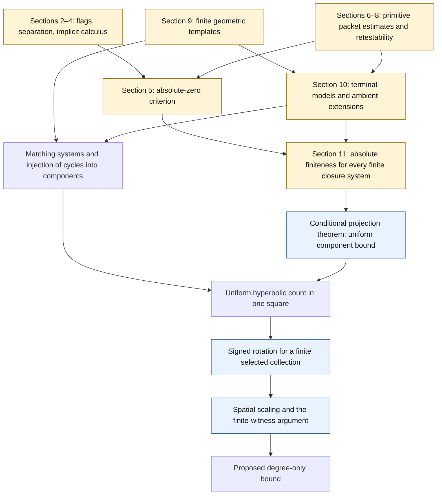

# The proof as a sequence of contracts

中文提示：这张图区分两件事——抽象推导是否正确，以及原稿是否已经为具体方程交付了全部假设。虚线框不是“发现漏洞”，而是尚未完成独立审查的输入。

## Target and conventions

For a polynomial vector field $V=(P,Q)$ on the real plane, a limit cycle is the geometric image of a nonconstant periodic solution, isolated from other periodic orbits in an open neighborhood. Count each image once. A center contributes no limit cycles. The proposed theorem is

$$
\forall d\geq 1\quad \exists B(d)<\infty\quad
\forall V\text{ with }\deg V\leq d,\quad \#\operatorname{LC}(V)\leq B(d).
$$

Neither an effective formula for $B(d)$ nor a classification of arrangements is supplied. No hypothesis of hyperbolicity, bounded coefficients, or bounded cycle location occurs in this target. See [source Theorem 1.1](https://github.com/openai/math/blob/4eaee87548250b2682affda7d05d947c05554bae/preprints/uniform-bounds-for-planar-polynomial-limit-cycles-September-24-2026/build/sections/01-introduction.tex#L12).

## Dependency diagram

Yellow nodes contain substantial source obligations not independently verified in this repository. Blue nodes have detailed reconstructed proofs, conditional on their inputs. The matching node has locally checked mechanisms, but still needs the source's geometric and analytic construction. The graph describes logical dependence, not a score for the probability of correctness.

## A short conditional assembly theorem

Fix $d$ and a fixed open square $Q$. Suppose the following data have been constructed.

**C1. Finite encoding.** There is a finite set $\mathcal W_d$ and a finite exception bound $T_d$. Each word $w$ has a fixed finite-dimensional open analytic system

$$F_w(p,x)=0,\qquad g_{w,j}(p,x)>0.$$

For every field $V$ of degree at most $d$, all but at most $T_d$ of its periodic orbits contained in $Q$ have a representation in one such system. For fixed $V,w$, the parameter $p_w(V)$ is common to all cycles assigned that word and preparation choice. Endpoint-dependent data belong among the unknowns, not among parameters allowed to vary independently for each cycle.

**C2. Regular charts and separation of cycles.** The representation of a hyperbolic cycle belongs to at least one of the finitely many maximal-minor charts of $F_{w,x}$. In a fixed chart and fixed fiber, two different hyperbolic cycles cannot have representations in the same connected component.

**C3. Complete domains and absolute finiteness of the closure.** On each chart, the data satisfy the full hypotheses of the projection theorem: positive-margin completeness, full row rank, and finite isolated zero sets for *every fixed finite generated system*, with all coordinates treated as unknowns and original graph/domain restrictions retained.

Then the conditional projection theorem gives numbers $N_{w,I}$, independent of $p$, such that

$$B_*(d)=T_d+\sum_{w\in\mathcal W_d}\sum_I N_{w,I}<\infty$$

bounds the hyperbolic cycles in $Q$. Assign each represented cycle one word and one regular chart. C2 injects the assigned cycles into components; C3 bounds those components. Multiple possible representations only cause harmless overcounting.

Now take any **finite** collection of isolated cycles of any field of degree at most $d$. Affine scaling moves the collection into $Q$ and preserves degree. The signed-rotation lemma gives a nearby field of the same degree with at least as many hyperbolic cycles inside $Q$. Their count is at most $B_*(d)$. If the original field had more than $B_*(d)$ cycles, selecting $B_*(d)+1$ would contradict this conclusion. No prior theorem of individual finiteness is used.

This proves the target **provided C1–C3 hold**. The [source matching theorem](https://github.com/openai/math/blob/4eaee87548250b2682affda7d05d947c05554bae/preprints/uniform-bounds-for-planar-polynomial-limit-cycles-September-24-2026/build/sections/11-counting.tex#L220) packages these contracts together. Separating them makes clear which part an objection concerns.

## What the intermediate mechanisms actually establish

| Claim ID | Input | Output | Current extent of review |
| --- | --- | --- | --- |
| GEO | Bounded degree; subanalytic preparation and termination | Finite geometric alphabet and bounded word length, before choosing a sequence | Source obligation |
| TERM | Each prepared passage and its allowed endpoint regimes | Exact terminal kernels on independent argument domains | Source obligation |
| SEP | Full complex packet hypotheses on a saturated flag | First nonzero term dominates, or exact vanishing | Source obligation; real flatness alone is insufficient |
| CALC | Packet library and regular ordinary changes | Required differential and implicit closure | Source obligation |
| ELIM | Separation, calculus, retestability, recoverable old free input | Absolute isolated-zero finiteness | Quantifier structure unpacked; estimates unverified |
| CLOS | Arbitrary one finite generated matching system | Every hypothesis of ELIM, after exact graph/jet lifting | Local algebra checked; analytic obligations remain |
| MATCH | Exact local physical validity and hyperbolicity | Full row rank and distinct-cycle/component separation | Local argument unpacked |
| UNI | C3 for one fixed analytic system | Uniform fiber component bound | Complete conditional reconstruction |
| ROT | Any finite collection of isolated cycles | At least as many nearby hyperbolic cycles, one rotation sign | Detailed reconstruction |
| SCALE | One-square bound and ROT | Bound for the whole plane, including potentially infinite collections | Detailed reconstruction |

The machine-readable [ledger](../reviews/claims.json) records dependencies and source anchors. Its status labels describe work performed, not a theorem-prover result.

## Three different uses of finiteness

1. **Geometric finiteness:** for fixed $d$, the words and their dimensions are fixed before any bad sequence is selected.
2. **Analytic sequential finiteness:** after fixing one finite system and a hypothetical infinite isolated solution sequence, a subsequence may admit a finite flag and a finite internal subdivision count $K$ depending on that sequence.
3. **Parameter uniformity:** after proving absolute finiteness for every system in the required closure, the independent projection theorem supplies a uniform bound for each fixed matching system.

The second finiteness is not a finite cover of coefficient space. It need not be: it is used inside a contradiction establishing the premise of the third step. Conversely, a sequence-dependent geometric alphabet could not replace the first step. This is a specific point to verify in the finite-template construction.

## Suggested division of specialist review

- A differential topologist can check UNI without reading the packet machinery.
- A planar dynamics specialist can check MATCH, ROT, SCALE and the boundary crossing argument, while explicitly assuming the terminal coordinate identities.
- A real analytic/subanalytic geometry specialist can check GEO and the ordinary elimination inputs.
- An asymptotic/complex analysis specialist can check SEP, CALC, the primitive estimates, and the retestability interface in ELIM/CLOS.

Each review should identify the assumptions it accepts. A proof of one box does not certify the boxes feeding it.
